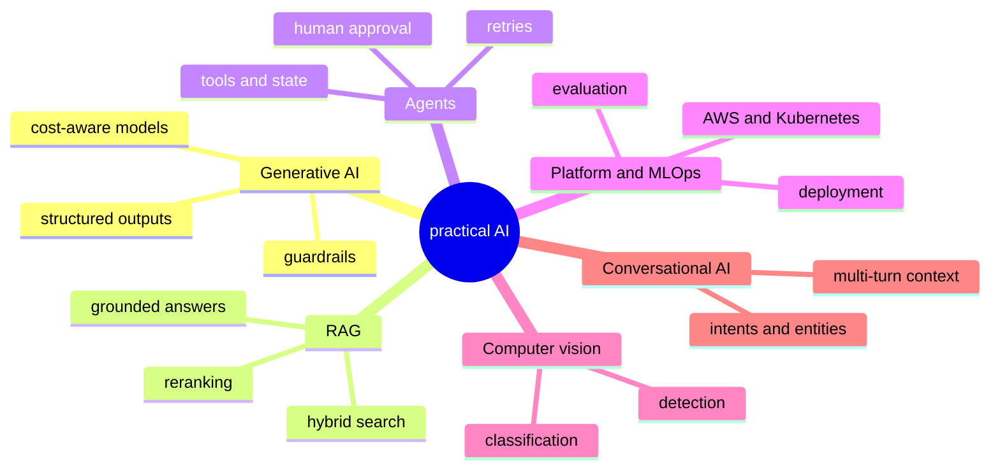

<h1>Joel Davis senior ai platform engineer</h1>

I build production AI systems: **agentic workflows**, **retrieval-augmented generation**, and the **backend platforms** that take them from prototype to production.

#### Built and running

🗓️ **Care Agent** · a scheduling agent that checks records and coverage, drafts the booking, then waits for a care coordinator's approval `LangGraph` `FastAPI` `PostgreSQL`

📄 **DocFlow** · reads scanned claim forms, extracts the fields that matter, and routes low-confidence ones to a reviewer `Textract` `Celery` `Lambda`

🧪 **EvalBench** · scores every retrieval and prompt change against a fixed question set and blocks the merge if quality drops `Ragas` `MLflow` `Databricks`

🏠 **RoomSense** · classifies rooms and detects amenities in listing photos, turning images into searchable metadata `TensorFlow` `Keras` `Kubernetes`

💬 **Converse** · turns free-form requests into intents, entities and a next action, follow-ups included `PyTorch` `spaCy` `gRPC`

🧭 **Vector Atlas** · semantic search with a visual explorer that shows how documents cluster and why a result matched `pgvector` `LlamaIndex` `React`

#### A little about me

12+ years as an AI and software engineer at startups and large tech companies. I care about practical AI: systems that leave the prototype stage, scale cleanly, and get built in close collaboration with the people who use them.

       

